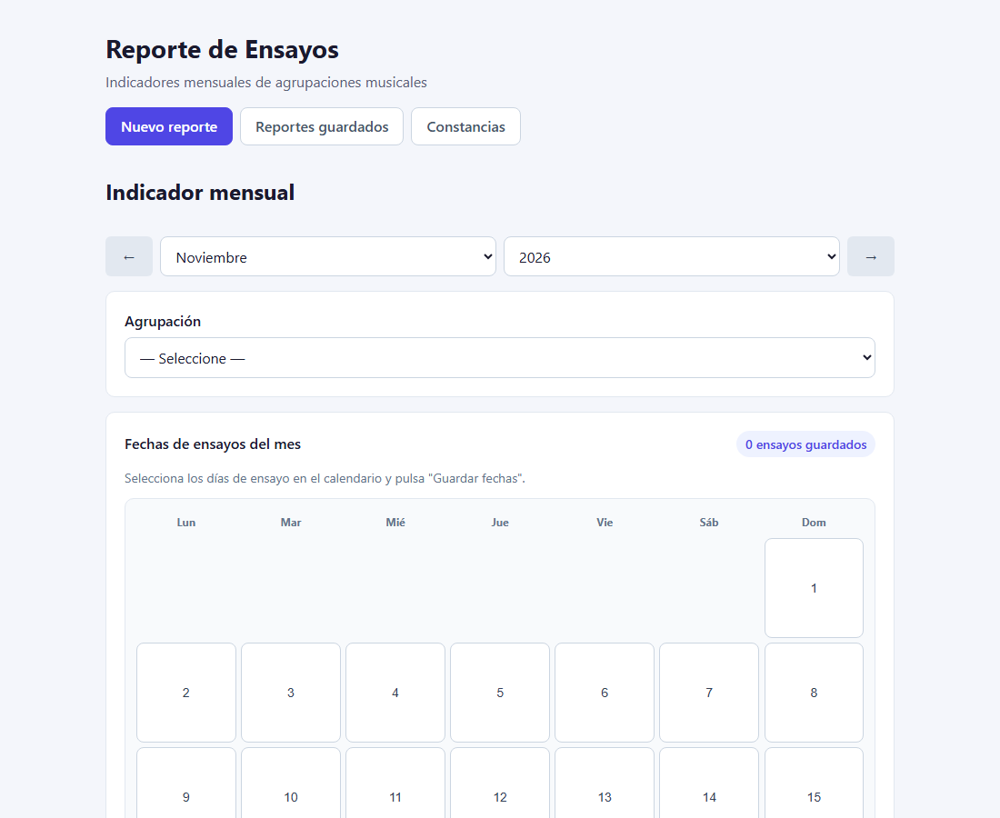
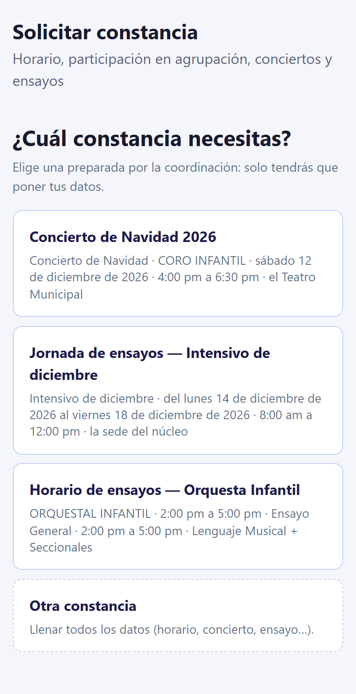
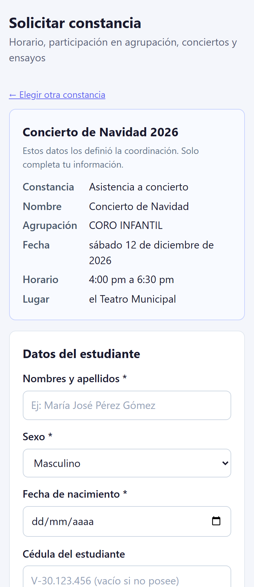
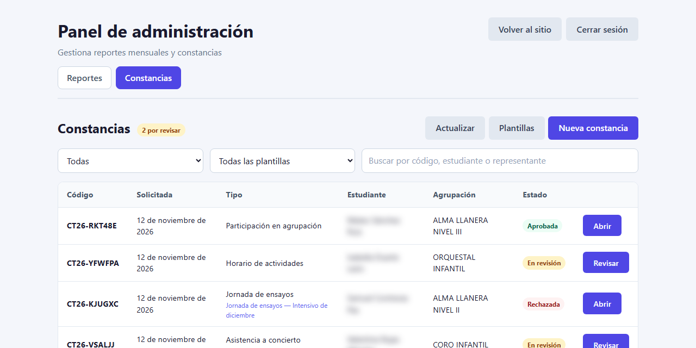
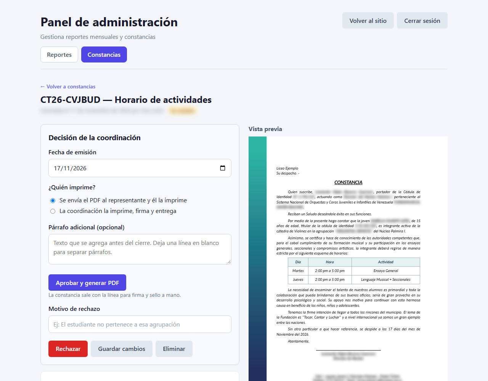
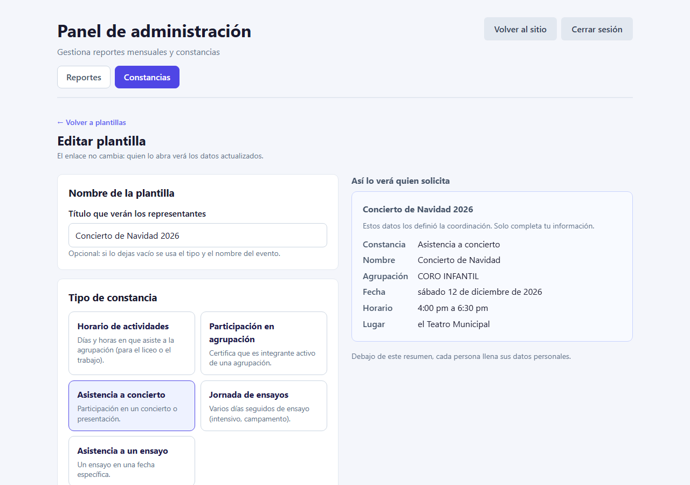
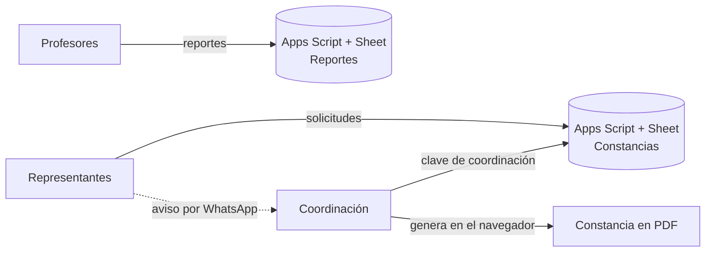

# Reporte de Ensayos

Aplicación web para un núcleo de orquestas y coros juveniles: registra los
**indicadores mensuales** de cada agrupación (ensayos, repertorio y matrícula) y
gestiona las **constancias** que piden representantes y estudiantes (horario,
participación, conciertos y ensayos), desde la solicitud hasta el PDF listo para
firmar.

> Las capturas usan datos ficticios y tienen difuminados los nombres, cédulas y
> teléfonos.

## Qué hace

### Página de inicio

Presenta el núcleo con la información de sus láminas institucionales (programas,
reseña, cifras, equipo por cargos y ubicación) y da tres accesos: **constancias**
para representantes, **profesores** (reportes de ensayo) y **coordinación**. El
contenido está en [`src/features/inicio/contenido.ts`](src/features/inicio/contenido.ts).

| Ruta | Para quién |
| --- | --- |
| `/` | Inicio |
| `/constancias`, `/p/:codigo` | Representantes: solicitar constancias |
| `/profesores` | Profesores: entran con su cédula y registran los reportes de sus agrupaciones |
| `/admin` | Coordinación (con clave): reportes, profesores y constancias |

### Reportes mensuales

- Indicador por agrupación y mes: fechas de ensayo en un calendario, repertorio
  trabajado y matrícula por edad y sexo.
- Los reportes se sincronizan con Google Sheets y funcionan sin conexión: si no
  hay internet, se guardan en el navegador y se envían al volver la conexión.
- Exportación a Excel y panel para revisar, editar o eliminar reportes.



### Constancias

1. **La coordinación crea plantillas** (opcional): fija el tipo, la fecha, los
   días, las horas y el lugar de un concierto, una jornada o un horario. Las
   plantillas vigentes aparecen al entrar a la página de constancias y cada una
   tiene un enlace corto para compartir en el grupo de la agrupación.
2. **El representante solicita**: elige la plantilla (o llena todo a mano) y solo
   pone sus datos. Los del representante se piden únicamente si el estudiante es
   menor de edad. Al enviar, avisa a la coordinación con un mensaje corto de
   WhatsApp.
3. **La coordinación revisa** en el panel: corrige datos, ve la constancia en vivo,
   la aprueba o la rechaza con un motivo, y genera el **PDF** para imprimirlo o
   enviárselo al representante.

El texto se redacta solo con el formato institucional del núcleo: edad calculada a
la fecha de emisión, tiempo verbal según el evento («participó» / «participará»),
la tabla de horario cuando aplica y el cierre con la fecha de emisión.

| Plantillas disponibles | Solicitud con plantilla |
| --- | --- |
|  |  |

**Panel de coordinación**







## Cómo funciona



- **Sitio estático** en GitHub Pages; cada push a `main` se publica con GitHub
  Actions.
- **Dos servicios independientes** en Google Apps Script, cada uno con su propio
  Google Sheet: uno para reportes y otro para constancias.
- El panel de coordinación (reportes y constancias) se abre con una sola clave
  que valida el servidor y que vive en las propiedades del script, no en el
  código.
- El **PDF se genera en el navegador** con `@react-pdf/renderer`; la librería se
  descarga solo cuando se pide el primer PDF.

## Tecnologías

React 19 · TypeScript · Vite · React Router · TanStack Query · React Hook Form ·
@react-pdf/renderer · SheetJS · Google Apps Script · GitHub Pages

## Desarrollo local

Requiere [Node.js](https://nodejs.org/) 20 o superior.

```bash
npm install
npm run dev      # http://localhost:5173
npm run build    # compilación de producción en dist/
```

## Configuración

Cada servicio se despliega desde su propio Google Sheet. Las instrucciones paso a
paso están en:

- Reportes: [`apps-script/INSTRUCCIONES.md`](apps-script/INSTRUCCIONES.md)
- Constancias: [`apps-script/constancias/INSTRUCCIONES.md`](apps-script/constancias/INSTRUCCIONES.md)

Las claves de servidor van en **Propiedades del script** de Apps Script, nunca en
el repositorio.

## Estructura

```
apps-script/              Backends en Google Apps Script
  Codigo.gs               Reportes mensuales
  constancias/Codigo.gs   Constancias (solicitudes y plantillas)
src/
  features/
    reporte-mensual/      Formulario y lista de reportes
    constancias/          Formulario, texto de la constancia y PDF
    admin/                Panel: reportes, constancias y plantillas
  pages/                  Páginas públicas
  lib/                    Sincronización, almacenamiento y Excel
public/img/               Logo y recursos de la constancia
docs/capturas/            Imágenes de este README
```
